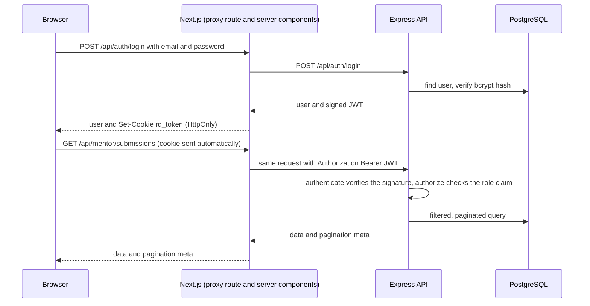

# Project Submission & Review Dashboard

A full-stack dashboard where students submit projects and mentors review them. Built for the Programming Hero Associate Web Instructor assessment.

## Live demo

| | |
|---|---|
| Web app | https://review-dashboard-neon.vercel.app/ |
| API health check | https://review-dashboard-api.onrender.com/api/health |

| Role | Email | Password |
|---|---|---|
| Mentor | mentor@example.com | mentorPH@2026 |
| Student | Sign up on the site, or use the demo button on the login page | |

The login page has one-click "Fill demo" buttons when demo accounts are configured. The free hosting tiers sleep when idle, so the first request after a pause can take a few seconds.

## What it does

**Students** sign up, submit a project (name, GitHub repository, live link, description), and follow its review status and the mentor's feedback. A rejected project can be fixed and resubmitted.

**Mentors** see every submission in a server-paginated table, filter it by status, search by project or student name, open the repository and live link, and approve or reject with feedback. A statistics card shows how many submissions are waiting.

**Authentication** uses JWT-based role-based access control. Students sign up themselves. The mentor account is seeded into the database.

## Requirements checklist

| Requirement | Where it lives |
|---|---|
| Submission form (name, repo URL, live link, description) | `apps/web/src/components/student/submission-form.tsx` |
| Robust validation | The same Zod rules on the client (`apps/web/src/lib/validation`) and the API (`apps/api/src/modules/*/*.schema.ts`) |
| Duplicate prevention | URL normalization and a service check in `submission.service.ts`, backed by a database unique constraint on `(studentId, repoUrl)` |
| Rate limit | `apps/api/src/middlewares/rateLimiter.ts`: 5 submissions per 15 minutes per user |
| Paginated mentor table | `mentor.service.ts` (`skip`/`take` plus a count in one transaction) and `submissions-panel.tsx` |
| Approve and reject | `reviewSubmission` in `mentor.service.ts` and `review-dialog.tsx` |
| Server-side Approved/Rejected filters | The `status` and `search` query parameters become a Prisma `where` clause. The filters are never applied in the browser |
| Aggregated statistics | `getStats` runs one `groupBy`. Rendered by `stats-overview.tsx` |
| Login and signup pages | `apps/web/src/app/(auth)` |
| Seeded mentor | `apps/api/prisma/seed.ts` |
| TypeScript, Next.js, Tailwind, ShadCN, Express, PostgreSQL, Prisma, JWT RBAC | See the table below |

## Tech stack

| Layer | Choice |
|---|---|
| Language | TypeScript (strict) |
| Frontend | Next.js (App Router), React, Tailwind CSS, ShadCN UI, TanStack Query, React Hook Form |
| Validation | Zod, on both client and server |
| Backend | Express |
| Database | PostgreSQL through Prisma ORM (Neon in deployment) |
| Auth | JWT (HS256), role-based access control, bcrypt password hashing |
| Tests | Vitest and Supertest against a real PostgreSQL database |
| Tooling | pnpm workspaces monorepo, ESLint |

## Architecture

The browser never talks to the Express API directly, and it never holds the JWT. Next.js route handlers act as a thin same-origin proxy.



### Project structure

```
review-dashboard/
├── apps/
│   ├── api/                  Express and Prisma API
│   │   ├── prisma/           schema, migrations, seed script
│   │   ├── src/
│   │   │   ├── middlewares/  authenticate, authorize, validate, rate limiter, error handler
│   │   │   ├── modules/      auth, submissions, mentor (schema, service, controller, routes)
│   │   │   ├── lib/          Prisma client
│   │   │   └── utils/        JWT, password hashing, ApiError, response helpers
│   │   └── tests/            Vitest and Supertest integration tests
│   └── web/                  Next.js app
│       └── src/
│           ├── app/          routes: landing, auth, student, mentor, API proxy
│           ├── components/   forms, tables, dialogs, UI primitives
│           ├── hooks/        TanStack Query hooks
│           └── lib/          API client, validation schemas, session helper
└── docs/postman/             Postman collection and environments
```

Each API feature is a small module with four files: schema (Zod), service (business logic), controller (HTTP layer) and routes. Controllers contain no business logic, and services know nothing about HTTP.

## Security model

- **Authentication and authorization are separate middlewares.** `authenticate` answers "who are you?" by verifying the token signature. `authorize(role)` answers "are you allowed?" by checking the role. Routes compose them: `authenticate, authorize("MENTOR")`.
- **The role is a signed claim in the JWT**, so authorization needs no database lookup on each request. This keeps the check fast. The trade-off is that a role change only takes effect when the token expires (1 day). Sensitive ownership checks should still go to the database.
- **The algorithm is pinned** to HS256 when verifying, which blocks algorithm-confusion attacks. The token payload is validated with Zod after verification.
- **The session lives in an httpOnly, SameSite=Lax cookie** (Secure in production), set by the Next.js proxy. JavaScript on the page cannot read it, so an XSS bug cannot steal the token. The token is also removed from the response body before it reaches the browser.
- **Two layers of route protection in the web app.** `proxy.ts` makes a fast, optimistic redirect from the cookie. Server layouts then ask Express for the real user. The proxy is for speed and UX only. Express is the authority.
- **A role can never be chosen by a request.** Signup always creates a student, and the mentor is seeded.
- **Login returns the same message** for an unknown email and a wrong password, so attackers cannot discover which emails exist.
- **Passwords** are hashed with bcrypt (cost 12) and limited to 72 characters, the most bcrypt uses.
- **Defense in depth for duplicates:** a service check gives a friendly error, and a database unique constraint covers race conditions.
- **Atomic reviews:** a review is one `updateMany` guarded by `status = PENDING`, so two mentors cannot review the same submission twice.
- **HTTP hardening:** Helmet, a restrictive CORS setting, a 100 KB JSON body limit, and error responses that never include stack traces in production.

## Decisions on the ambiguous requirements

| Question | Decision and reason |
|---|---|
| What counts as a duplicate? | The same repository URL after normalization (lowercase, no `.git`, no trailing slash). Another student's repository is blocked too, since that is almost certainly copying |
| Can a rejected project be fixed? | Yes. Submitting the same repository again reopens the rejected submission as PENDING and clears the old review. Pending and approved ones return `409`. Review history is not kept, which would need its own table |
| What does the rate limit key on? | The authenticated user, not the IP address, so classrooms behind one network are not punished. It counts every attempt, including failed ones. The store is in memory, so a multi-instance deployment would need Redis |
| Who is the "admin"? | A mentor, seeded from environment variables. There is no admin UI |
| Can a mentor reject without a reason? | No. Rejection requires feedback of at least 5 characters. Approval feedback is optional |
| Can a submission be reviewed twice? | No. A second review returns `409` |
| Where does filtering happen? | In the SQL query. Status, search and pagination state also live in the URL, so a refresh or shared link restores the same view |
| How are the statistics computed? | One grouped count query, not four separate counts |

## Getting started

**Prerequisites:** Node.js 22 or newer, pnpm 10 or newer, and PostgreSQL (local, or a free [Neon](https://neon.tech) database).

```bash
git clone https://github.com/ShafinRME/review-dashboard.git
cd review-dashboard
pnpm install

cp apps/api/.env.example apps/api/.env
cp apps/web/.env.example apps/web/.env.local
```

Edit `apps/api/.env`: set `DATABASE_URL` and a long random `JWT_ACCESS_SECRET` (at least 32 characters). Optionally set the `SEED_MENTOR_*` values. Then create the schema, seed the mentor and start both apps:

```bash
pnpm --filter api db:deploy     # apply migrations (use db:migrate while developing)
pnpm --filter api db:seed       # create the mentor account
pnpm dev                        # API on :4000, web on :3000
```

Open http://localhost:3000. Log in as the seeded mentor, or sign up as a student.

### Environment variables

**`apps/api/.env`**

| Variable | Purpose |
|---|---|
| `NODE_ENV` | `development`, `test` or `production` |
| `PORT` | API port (default 4000) |
| `CORS_ORIGIN` | Allowed origin(s), comma separated |
| `DATABASE_URL` | PostgreSQL connection string |
| `JWT_ACCESS_SECRET` | Signing secret, at least 32 characters |
| `JWT_ACCESS_EXPIRES_IN` | Token lifetime (default `1d`) |
| `SUBMISSION_RATE_LIMIT_MAX` | Submissions allowed per user per 15 minutes (default 5) |
| `SEED_MENTOR_NAME`, `SEED_MENTOR_EMAIL`, `SEED_MENTOR_PASSWORD` | Used only by the seed script |
| `TEST_DATABASE_URL` | A separate database for the tests. Its name must contain `test` |

**`apps/web/.env.local`**

| Variable | Purpose |
|---|---|
| `API_URL` | Base URL of the Express API, for example `http://localhost:4000/api`. Used server-side only |
| `NEXT_PUBLIC_DEMO_*` | Optional demo accounts that enable the "Fill demo" buttons |
| `NEXT_PUBLIC_SITE_URL` | Optional public URL for absolute metadata |

### Scripts

| Command | What it does |
|---|---|
| `pnpm dev` | Start the API and the web app together |
| `pnpm test` | Run the API integration tests |
| `pnpm --filter api db:migrate` | Create and apply a migration (development) |
| `pnpm --filter api db:deploy` | Apply existing migrations (production) |
| `pnpm --filter api db:seed` | Create or update the mentor account |
| `pnpm --filter api db:studio` | Browse the database in Prisma Studio |
| `pnpm --filter api typecheck` | Type-check the API, seed script and tests |
| `pnpm --filter web lint` and `typecheck` | Lint and type-check the web app |

## API reference

Responses use one envelope. Success: `{ "success": true, "data": {...}, "meta": {...} }`. Errors: `{ "success": false, "message": "...", "errors": [{ "field": "...", "message": "..." }] }`.

| Method | Path | Access | Description |
|---|---|---|---|
| GET | `/api/health` | Public | Health check |
| POST | `/api/auth/signup` | Public | Create a student account and return a token |
| POST | `/api/auth/login` | Public | Log in and return a token |
| GET | `/api/auth/me` | Any signed-in user | Return the current user |
| POST | `/api/submissions` | Student | Submit a project (`201`), or reopen a rejected one (`200`) |
| GET | `/api/submissions/mine` | Student | The student's own submissions, newest first |
| GET | `/api/mentor/stats` | Mentor | Counts: total, pending, approved, rejected |
| GET | `/api/mentor/submissions` | Mentor | Paginated list. Query: `page`, `limit` (1 to 50, default 10), `status` (`PENDING`, `APPROVED`, `REJECTED`), `search` |
| PATCH | `/api/mentor/submissions/:id/review` | Mentor | Body: `status` (`APPROVED` or `REJECTED`) and `feedback` (required when rejecting) |

Status codes you can expect: `400` validation, `401` missing or invalid token, `403` wrong role, `404` unknown submission, `409` duplicate or already reviewed, `429` rate limit.

In the browser, the web app exposes the same routes under its own origin. `POST /api/auth/logout` exists only in the web proxy, where it clears the cookie.

A ready-to-run Postman collection with 50 requests and tests is in [`docs/postman`](docs/postman). Import the collection and the `local` environment, run **Login (student)** and **Login (mentor)**, then run any folder. Set `mentorPassword` in the environment first.

## Testing

The API has integration tests that send real HTTP requests to the app and use a real PostgreSQL database, with no mocks. They cover signup and login, token checks, role-based access for every route, validation, duplicate and resubmission rules, pagination, filtering, search, the review rules and the rate limit.

```bash
createdb review_dashboard_test            # or any database whose name contains "test"
# set TEST_DATABASE_URL in apps/api/.env
pnpm test
```

The test setup refuses to run against a database whose name does not contain `test`, so it cannot touch real data.

## Deployment

The database runs on Neon, the API on Render, and the web app on Vercel. The web app needs `API_URL` pointing at the deployed API. Because the browser only calls the web app's own origin, the API needs no CORS entry for the browser. Run `pnpm --filter api db:deploy` and `pnpm --filter api db:seed` once against the production database.

## Trade-offs and next steps

- **Access tokens only.** There is no refresh-token rotation, so a stolen token works until it expires. The cookie is httpOnly, which lowers that risk.
- **In-memory rate limiting** is per server instance. A shared store such as Redis would be needed for several instances, and the same Redis could cache the dashboard statistics.
- **No review history.** Resubmitting clears the previous review. An audit table would keep every round.
- **End-to-end browser tests** (for example Playwright) would complement the API tests.
- **Role changes** apply when a token expires. Immediate revocation would need token versioning or short-lived tokens with refresh.
